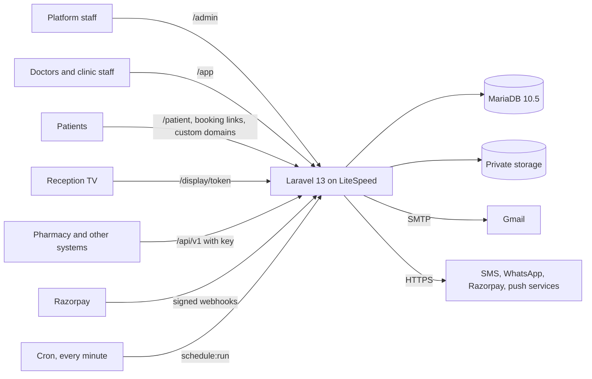
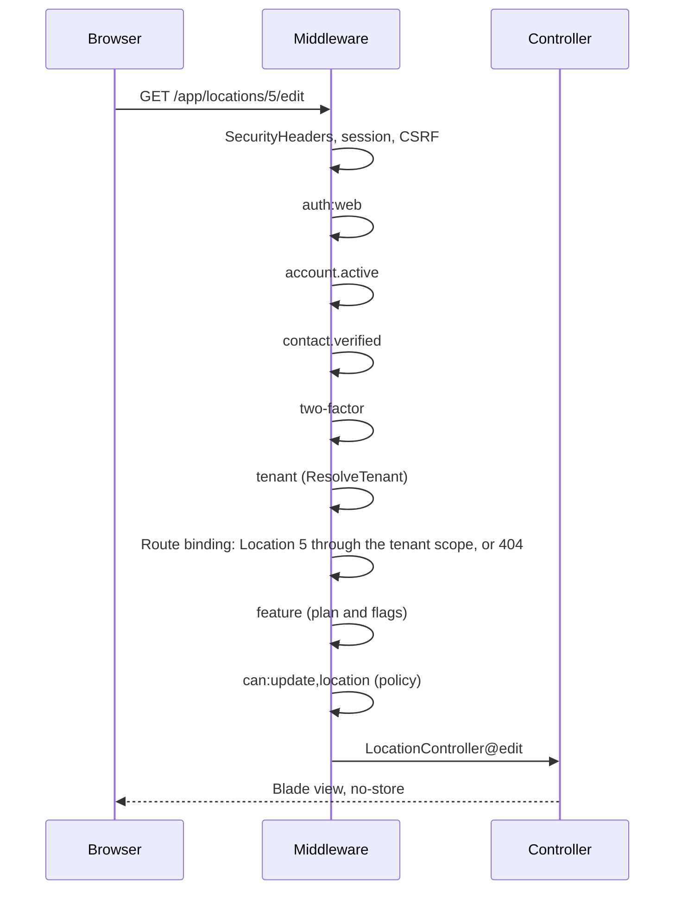
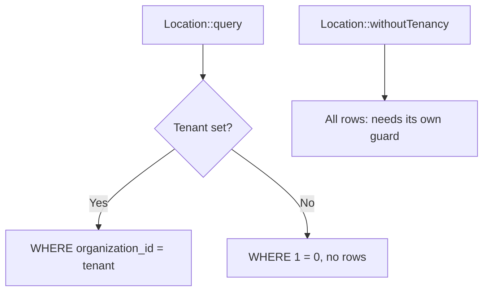
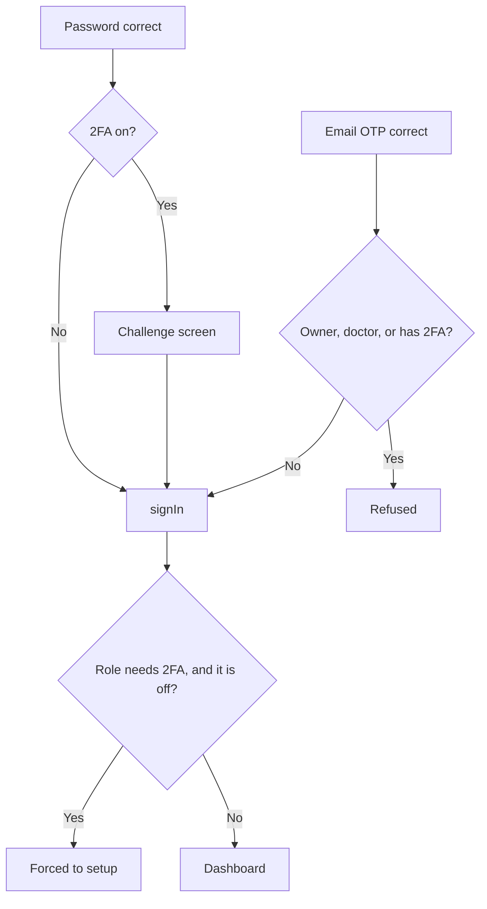
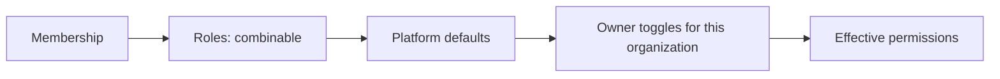
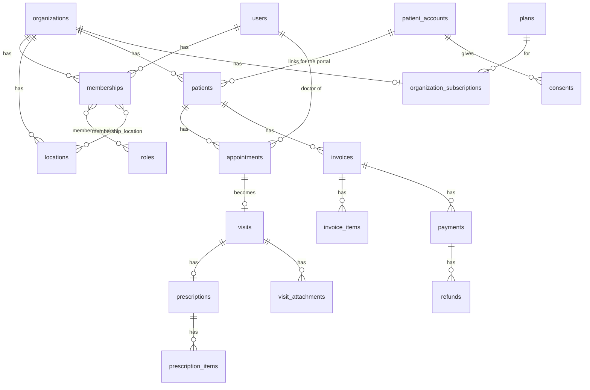
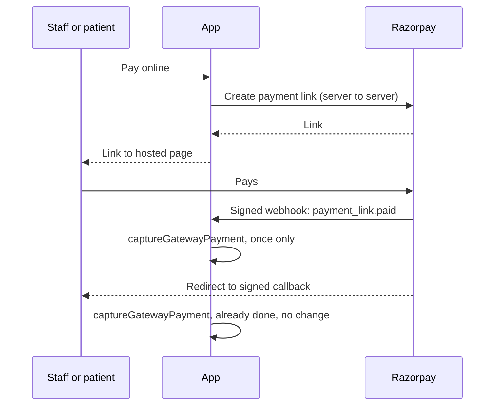
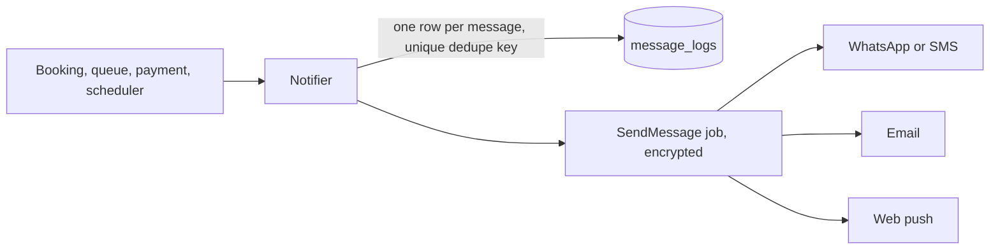

# CurePlus architecture

For developers joining the project. After reading this you should know how a request flows, where each thing lives, and which rules keep patient data safe. Change this file in the same commit as any change to what it describes.

**Contents:** [1 Overview](#1-overview) · [2 Code map](#2-code-map) · [3 Request lifecycle](#3-request-lifecycle) · [4 Multi-tenancy](#4-multi-tenancy) · [5 Identity and sign-in](#5-identity-and-sign-in) · [6 Authorization](#6-authorization) · [7 Data model](#7-data-model) · [8 Scheduling and double-booking](#8-scheduling-and-double-booking) · [9 Billing and payments](#9-billing-and-payments) · [10 Patient portal and consent](#10-patient-portal-and-consent) · [11 Messaging](#11-messaging) · [12 Platform business](#12-platform-business) · [13 Extending the system](#13-extending-the-system) · [14 Custom domains](#14-custom-domains) · [15 Backups and operations](#15-backups-and-operations) · [16 API and ABDM](#16-api-and-abdm) · [17 Audit and security](#17-audit-and-security) · [18 Hosting constraints](#18-hosting-constraints) · [19 PWA and frontend](#19-pwa-and-frontend) · [20 Testing](#20-testing) · [21 Decisions](#21-decisions)

## The rules that matter most

Break one of these and you risk exposing patient data or breaking production. Most are enforced by a test that fails when they are broken.

1. **Every table with `organization_id` has a model using `BelongsToOrganization`.** (`TenantIsolationTest`)
2. **`withoutTenancy()` is only for code with another guard on the data:** platform pages, the portal's `PatientRecords`, jobs. Every use should be easy to justify in review.
3. **Every tenant and admin route declares a `can:` permission.** (`AuthorizationTest`)
4. **Scheduled tasks use `Schedule::call`, never `Schedule::command`.** The host disables `proc_open`. (`PlatformFoundationTest`)
5. **Every new first-level URL goes in `cureplus.reserved_slugs`,** or an organization could claim it as a booking link. (`RegistrationTest`)
6. **The service worker never caches pages or API responses.** (`PlatformFoundationTest`)
7. **Secrets and clinical values never go in logs or audit metadata.** Audit entries store field names, not values.
8. **Medical and billing records are soft-deleted, never hard-deleted.**
9. **Use `dateTime`, not a non-null `timestamp`, in migrations.** MariaDB 10.5 gives the first non-null `TIMESTAMP` in a table `ON UPDATE CURRENT_TIMESTAMP`, which silently rewrites it on every update. (`PlatformFoundationTest`, on MariaDB only)
10. **Money is integer paise, and every gateway payment is credited through `captureGatewayPayment`.** That is where double-crediting is prevented.

## 1. Overview



One codebase and one database serve every organization. There are four portals, each an installable PWA:

| Portal | Path | Who | Sign-in |
|---|---|---|---|
| Super Admin | `/admin` | Platform staff | `platform` guard, password + 2FA |
| Clinic / Doctor | `/app` | Owners, doctors, staff | `web` guard, password + 2FA, or OTP for staff |
| Patient | `/patient`, `/{slug}` | Patients | `patient` guard, email OTP |
| Queue display | `/display/{token}` | Reception screen | Secret link, shows token numbers only |

The stack is deliberately plain: server-rendered Blade, a small amount of Alpine.js, and no build step on the server. That is what keeps it fast on 3G and able to run on shared hosting.

## 2. Code map

| Path | What lives there |
|---|---|
| `config/cureplus.php` | Domain, security limits, OTP, SMS, CAPTCHA, reserved slugs, backups, PWA portals |
| `config/rbac.php` | Source of truth for roles, permissions and platform abilities |
| `config/plans.php` | Features and the routes each one switches, grace period, platform Razorpay |
| `config/messages.php` | Every automatic message, WhatsApp and push settings, quiet hours |
| `app/Tenancy/` | `TenantContext`, `OrganizationScope`, `BelongsToOrganization`, `Jobs/RestoresTenant` |
| `app/Models/` | Eloquent models. `Concerns/` holds `Auditable`, `HasTwoFactor`, `HasLoginProtection` |
| `app/Actions/` | One business operation per class, such as `RegisterOrganization`, `SavePrescription` |
| `app/Services/` | `AppointmentService`, `DoctorCalendar`, `AuditLogger`, `PlatformSettings` and more |
| `app/Services/Auth/` | `LoginFlow`, `OtpService`, `TwoFactorService` |
| `app/Services/Billing/` | `BillingService`, `InvoiceCalculator`, `FeeResolver`, `SubscriptionService`, `PlanLimits`, `FeatureGate` |
| `app/Services/Messaging/` | `Notifier`, `ReminderScheduler`, providers |
| `app/Services/Portal/` | `PatientRecords`, `PublicBooking`, `CrossOrganizationHistory`, `AccountEraser` |
| `app/Services/Domains/`, `Backups/`, `Reports/`, `Payments/`, `Fhir/` | One folder per subsystem |
| `app/Contracts/` | Swappable providers: `SmsProvider`, `WhatsAppProvider`, `PushSender`, `PaymentGateway`, `CaptchaVerifier`, `DnsResolver` |
| `app/Http/Controllers/{Admin,App,Auth,Patient,Api/V1}` | Thin controllers per portal |
| `app/Http/Middleware/` | `ResolveHost`, `BlockIps`, `ResolveTenant`, `SecurityHeaders`, `EnsureFeatureEnabled`, sign-in gates |
| `app/Policies/` | Model-level checks. `TenantPolicy` is the base |
| `routes/` | `web` public and auth, `app`, `admin`, `patient`, `api`, `stateless` (no cookies), `booking` (catch-all, loaded last), `console` (scheduler) |
| `lang/` | `hi.json` and `bn.json` for patient-facing text, `*/rx.php` for prescriptions |
| `resources/views/components/` | Layouts and the small component set |
| `resources/js/` | Alpine components (`app.js`) and PWA logic (`pwa.js`) |
| `resources/pwa/sw.js` | Service worker template |
| `public/build/` | Compiled assets, **committed on purpose** |

## 3. Request lifecycle

Two global middleware run first on everything: `BlockIps`, then `ResolveHost`, which decides what a hostname may reach (§14). A request to `/app/locations/5/edit` then goes:



**The order is load-bearing.** `ResolveTenant` must run before route-model binding, or `{location}` would load with no tenant set. Laravel moves middleware named in the priority list ahead of everything else, so the full chain is spelled out in `bootstrap/app.php`.

## 4. Multi-tenancy

Single database, with `organization_id` on every tenant table.



- **`TenantContext`** holds the current organization, membership and location for one request or job.
- **`ResolveTenant`** fills it on every `/app` request. The session stores only which organization was picked; access is re-checked against active memberships each time, so a removed member loses access on their next click.
- **`OrganizationScope`** filters every query. **With no tenant it returns nothing.** This is the most important design choice here: forgetting the context produces an empty page rather than a data leak.
- **`BelongsToOrganization`** also fills `organization_id` on create, refuses to write into another tenant, and refuses to move a row between tenants.

### Working with it

```php
// In a portal request: nothing to do. The scope is already applied.
$locations = Location::query()->active()->get();

// Platform admin code: opt out explicitly.
$all = Location::withoutTenancy()->where('organization_id', $id)->get();

// Acting for one organization from somewhere with no tenant:
app(TenantContext::class)->run($organization, fn () => $pdf->render($prescription));
```

A queued job keeps only the organization's id and restores the tenant through job middleware:

```php
public function middleware(): array
{
    return [new RestoresTenant($this->organizationId)];
}
```

### Things that catch people out

- **Eager loads obey the scope.** A relation loaded before a tenant exists comes back empty. `Membership::locations()` opts out for this reason: the pivot already ties it to one membership. In the patient portal, `PatientRecords` opts out per relation.
- **`Rule::exists` ignores the scope.** It queries the table directly, so always add `->where('organization_id', ...)`.
- **Raw `DB::table()` ignores the scope too.** Use it only for tables with no tenant data.

## 5. Identity and sign-in

There are three kinds of account, kept separate on purpose:

| Account | Table | Guard | Notes |
|---|---|---|---|
| Clinic person | `users` | `web` | One login across any number of organizations |
| Platform staff | `platform_admins` | `platform` | Cannot hold tenant permissions |
| Patient | `patient_accounts` | `patient` | Email OTP only, links their records for the portal |

### Every staff and admin login goes through `LoginFlow`



- **Owners, doctors and admins must have 2FA.** System configuration can extend this to all staff.
- **Email OTP login is only for staff without 2FA.** For an owner, an email login followed by an email 2FA code would be one factor used twice.
- **There is no "remember me".** A remembered login would skip 2FA, and reception PCs are shared.
- **Lockout:** five failures lock the account for 15 minutes. Failed 2FA codes count too.
- **Forms do not reveal who has an account.** Login, OTP and password reset answer the same way either way.
- **OTPs** are stored as keyed hashes, are single-use, and die after five wrong guesses. Every code goes by email, inside the request, because the queue may not run for up to a minute. If sending fails, `OtpDeliveryException` becomes a friendly message.
- **TOTP codes** cannot be replayed within their time window.
- **A lost phone:** recovery codes first, then an admin can reset 2FA with a stated reason. Admins can reset each other, never themselves.

### Sessions

`SESSION_DRIVER=tracked-database` uses `TrackedDatabaseSessionHandler`. Laravel's default stores the current guard's id in `user_id`, so admin 5 and clinic user 5 would look like the same person, and the clinic user could see and revoke the admin's session. Each guard therefore has its own column. Pages get a hash of the session id, never the id itself.

### Impersonation

An admin with `platform.impersonate` gives a reason, and is then signed in to the `web` guard as the organization's owner, alongside their own `platform` session. While this lasts a banner shows on every page, every audit row records the admin as `impersonator_id`, and password, 2FA, session and organization-switch routes return 403, so support can never take the account over.

## 6. Authorization

Two layers, and hiding a menu item is neither of them:

1. **`Gate::before`** in `AppServiceProvider` answers every permission key, for both guards.
2. **Policies** in `app/Policies` add record-level checks, including a second tenant check behind the scope.



- Roles come from `config/rbac.php`; `cureplus:sync-rbac` copies them to the database at each deploy.
- `organization_role_permissions` stores only differences from the default, so improved defaults still reach organizations that changed something else.
- **Owner cannot be edited,** so an organization cannot lock itself out. The last owner cannot be removed or demoted.
- **Clinical notes are for clinicians:** a receptionist can register a patient and take payment without being able to read why they came. A nurse records vitals but cannot read notes. A doctor can only sign their own consultations.
- **Platform roles** (`super_admin`, `support`, `sales`, `finance`) are a fixed map in config.

```php
Route::get('/reports', [ReportController::class, 'index'])->can('reports.view');
Route::put('/locations/{location}', [LocationController::class, 'update'])->can('update', 'location');
```

A second, separate layer is the plan: `EnsureFeatureEnabled` switches off routes the plan does not include (§12).

## 7. Data model



| Area | Tables | Scoped? |
|---|---|---|
| Identity | `users`, `platform_admins`, `patient_accounts`, `doctor_profiles`, `sessions` | Global |
| Tenants | `organizations`, `locations`, `memberships`, `invitations`, `organization_counters` | Yes |
| RBAC | `roles`, `permissions`, `permission_role`; `organization_role_permissions` | Global; overrides scoped |
| Clinical | `patients`, `doctor_availability`, `calendar_blocks`, `appointments`, `visits`, `vitals`, `visit_attachments`, `prescriptions`, `prescription_items`, `follow_ups` | Yes |
| Catalogue | `medicines`; `favourite_medicines`, `medicine_requests`, `templates` | Global; rest scoped (`templates` may be platform-wide) |
| Billing | `doctor_fees`, `service_items`, `invoices`, `invoice_items`, `payments`, `refunds`, `organization_integrations`, `webhook_events` | Yes |
| Portal | `consents`, `data_requests` | Bound to the account |
| Messaging | `message_logs`; `push_subscriptions`, `notification_preferences` | Scoped; bound to the subscriber |
| Business | `plans`, `coupons`, `announcements`, `announcement_reads`; `organization_subscriptions`, `platform_invoices`, `feature_flags`, `support_tickets`, `ticket_messages` | Global; rest scoped |
| Operations | `custom_domains`, `api_keys`; `platform_settings`, `blocked_ips`, `backup_runs`, `restore_tests`, `daily_metrics`, `breach_incidents`, `audit_logs`, `security_events`, `otp_codes`, `system_heartbeats` | First two scoped; rest global (`audit_logs` scoped, nullable) |

Conventions:

- `utf8mb4`, InnoDB, a foreign key and an index on every relation, soft deletes on clinical and identity records.
- Mobiles are stored as `+91XXXXXXXXXX`. They are contact details and a password-login name. Nothing is proved by a mobile.
- Patient emails are lowercased by the model, because portal linking compares them exactly.
- Organizations have a public `uuid`; the numeric id stays internal.
- **Encrypted at rest:** ABHA, allergies, complaints, history, diagnosis, notes, lab advice, patient instructions, push keys, integration settings, platform settings. Encrypted columns cannot be searched in SQL, so `abha_hash` makes ABHA searchable, and top diagnoses are counted in PHP.
- A patient is a separate row per organization. `patient_account_id` links them for the portal only; **records are never merged.**

## 8. Scheduling and double-booking

`doctor_availability` holds weekly hours per doctor, location and organization. `DoctorCalendar` turns those into slots and removes anything overlapping that doctor's appointments, **at every organization**, or a block that applies. Other organizations only learn that a time is busy, never who with.

`calendar_blocks` covers leave and holidays. A clinic can close its own diary. Only the doctor can block themselves everywhere.

**Double-booking is stopped twice:**

1. `AppointmentService::bookSlot` locks the doctor's `users` row inside a transaction, so bookings for one doctor run one at a time across every organization, and the overlap check sees the truth.
2. `UNIQUE (doctor_user_id, slot_key)` is the backstop. `slot_key` is null once an appointment is cancelled or a no-show, and MariaDB allows many nulls, which frees the slot. Walk-ins never hold one.

`ConcurrentBookingTest` races eight real OS processes from two organizations for one slot, and exactly one must win. It only runs on MariaDB.

**The queue:** tokens come from `SequenceService`, a locked per-day counter. The TV display (`/display/{token}`) is public because a TV has nobody to log in, so it shows only doctor names and token numbers.

## 9. Billing and payments

- **All money is integer paise.** `Money` converts at the edges, and `InvoiceCalculator` is pure arithmetic with a unit test.
- **GST:** tax treatment comes from the server's `service_items`, never the browser. A bill with any taxable line becomes a `gst_invoice`; otherwise it is a `receipt`. Exempt and taxable revenue are stored separately. Tax is added on top of the discounted price and shown as CGST and SGST.
- **Numbering:** a separate series per organization, location, document type and financial year.
- **Discounts** need the `billing.refund` permission and a reason. **Refunds** go to Razorpay first; if that fails, nothing is recorded.

### Razorpay



- **Hosted payment links, not Checkout.** Checkout needs the Key ID in the browser, and the spec says keys never reach the frontend.
- **A plain link, not a redirect.** The CSP's `form-action` blocks a form that redirects off-site, so payment goes through a "Continue to payment" page.
- **Each organization has its own keys and webhook URL,** `/webhooks/razorpay/{uuid}`, verified with that organization's secret. Keys are in `organization_integrations`, encrypted and masked.
- **Idempotent three ways:** a unique event id, the payment row locked and checked for `captured`, and a unique gateway payment id.
- Webhooks are in `routes/stateless.php`, outside CSRF, because the signature is the check. Rejected ones become security events.

## 10. Patient portal and consent

**Every portal read goes through `PatientRecords`.** There is no tenant in a patient's session, so each query opts out of the tenant scope and is pinned instead to the patient rows linked to this account. No other portal code reads clinical tables.

To render a PDF there, the tenant is set just for that call: `$tenant->run($organization, ...)`.

**Linking:** after OTP login, `PatientRecords::link` connects patient rows with the same email. The person has just proved they hold the address. A patient with no email on file stays out of the portal until the clinic adds one.

**Approval:** `OrganizationStatus` is `pending_verification`, `approved`, `rejected` or `suspended`. Only a suspension locks people out. `OrganizationVerification` holds the transitions and `requirements()`. Restrictions on unapproved practices sit in three layers: the `org.approved` route middleware for a friendly redirect, policies (`PatientPolicy::create`, `InvoicePolicy::create`, `PrescriptionPolicy::print`), and the services themselves (`RegisterPatient`, `GatewayFactory::forOrganization`, `Notifier::paidChannel`, `PublicBooking::organization`). Sample patients have `is_demo` and are deleted at first approval, with numbering reset. Restoring a suspended practice is not a first approval.

**Subscriptions switch:** `config('plans.enabled')` (`SUBSCRIPTIONS_ENABLED`, off). While off, `subscriptions.on` makes the pages 404, `FeatureGate` allows everything except per-organization overrides, `PlanLimits` returns no limit, and `SubscriptionService::enforce` does nothing.

**Booking never matches on mobile.** It reuses a clinic's record only when the proved email and the name both match. Otherwise knowing someone's name and number would attach a stranger's login to their record, so a mismatch makes a new record for the clinic to review.

**Per-clinic design:** colours, corners, logo, cover photo, tagline, about text, highlights, contact details and whether fees show are stored in `organizations.branding`, `brand_color` and `cover_image_path`, and edited at `/app/settings/design`. Layout and flow are shared by everyone. `BrandTheme` turns the colours into `--color-brand-*` and `--color-accent-*` overrides of the Tailwind theme, darkening the button shade until white text reaches 4.5:1 contrast. Values are validated as `#rrggbb` on save and checked again on output, because they go into a nonce-protected style block on public pages. Uploads are re-encoded by `BrandingService`. `PortalBrand` decides whose look the patient pages wear: the custom domain, else the clinic remembered in the session from its booking page, else the patient's only clinic, else the neutral look.

**Booking links:** `/{org}`, `/{org}/{doctor}`, and `/{doctor}` for a solo practice, whose organization slug is the doctor's. `routes/booking.php` is a catch-all, so it loads last. Nothing is saved until the mobile is proved by OTP, and a guest must tick consent first.

**Cross-organization history:** a doctor presses a button, the patient gets an OTP and reads it out if they agree, and `consents` records it for that doctor, that organization, for `CONSENT_DAYS`. Each view is logged in **both** organizations' audit logs. Patients can revoke it at any time, and it stops immediately.

**DPDP rights:** download my data (JSON), correction and deletion requests, handled in Super Admin, Data requests. A deletion erases the login and profile, and unlinks records; clinics keep medical and billing records. **Have counsel confirm this.**

**Languages:** patient-facing text uses `__()` with English as the key, so a missing translation shows English. Add a language with a new `lang/xx.json` and an entry in `cureplus.locales`. `MessageWording` lets admins change message text.

## 11. Messaging



- **Notifier decides, `SendMessage` sends.** WhatsApp is preferred and SMS is the fallback, not both, since each costs money. With neither set up, patients still get email and push. Email and push are free, so they are added when available.
- **A failed message never breaks the work that triggered it.** A payment or booking succeeds regardless, and the failure goes in `message_logs`.
- **A retry cannot message a patient twice.** Each planned message has a unique `dedupe_key`, so a repeated scheduler run inserts nothing and sends nothing.
- **`ReminderScheduler`** runs every 15 minutes, between 08:00 and 21:00. Overdue follow-ups become `done` if the patient came back, otherwise `missed`, which puts them on the staff call list.
- **Text stays free of clinical detail,** because lock screens show it to anyone nearby.
- **Documents by WhatsApp or SMS** use signed links that expire after `DOCUMENT_LINK_HOURS`. The link is the permission, so it is logged and short-lived.
- **Patients can mute each event.** A failed send stores only the exception's type, since its message can echo tokens or numbers.

## 12. Platform business

**Lifecycle:** registration starts a `trial`. When it ends the status is `past_due` with a grace period, then the organization is suspended. A signed `subscription.charged` webhook makes it `active`. Records are never touched.

- **Paying only lifts a non-payment suspension.** If an admin suspended the organization for another reason, a payment must not undo that.
- **A suspended owner can still pay,** because `subscription.renew` sits outside the tenant group.
- The platform's Razorpay account is separate from each organization's. `PlatformGateway` and `RazorpayGateway` share nothing.

**Features:** `config/plans.php` maps each feature to routes, and `EnsureFeatureEnabled` on the tenant group enforces them. `FeatureGate` checks an organization's flag, then a flag on its plan, then the plan's list. **An organization on no plan keeps everything,** so a new feature can never lock anyone out.

**Limits:** `PlanLimits` guards adding locations, staff and doctors. SMS and WhatsApp stop at the monthly allowance, recording `over_limit` so the owner can see why. Email and push do not count.

## 13. Extending the system

**Add a tenant-scoped feature:**

1. Migration with `foreignId('organization_id')->constrained()`, and indexes for your filters. Use `dateTime`, not a non-null `timestamp`.
2. Model with `BelongsToOrganization`, `Auditable`, and `SoftDeletes` if it is clinical or billing data, plus a factory.
3. Add permissions to `config/rbac.php`, then run `cureplus:sync-rbac`.
4. Add a policy extending `TenantPolicy`.
5. Add routes inside the `tenant` group in `routes/app.php`, each with `->can(...)`.
6. Add the model to `TenantIsolationTest::scopedModels()`, and add cross-tenant 404 tests.
7. Add it to the sidebar in `components/layouts/app.blade.php`. To put it behind a plan, add it to `config/plans.php`.

**Add a provider:** implement the interface in `app/Contracts`, then add a line where it is bound in `AppServiceProvider::register()`, or in `WhatsAppFactory` or `GatewayFactory`.

**Add a message:** add it to `config/messages.php`, and call `Notifier` with a dedupe key. Register the text for DLT and create the WhatsApp template before relying on it.

**Add a queued job with personal data:** implement `ShouldBeEncrypted`, because payloads otherwise sit readable in the `jobs` table. Mark secrets with `#[\SensitiveParameter]`.

**Add a top-level URL:** add it to `cureplus.reserved_slugs`.

## 14. Custom domains

`ResolveHost` decides what each hostname may reach:

| Host | Gets |
|---|---|
| `APP_DOMAIN`, `CONNECT_HOST` | Everything |
| An active custom domain of an active organization | Only the booking site and patient flow |
| Anything else | A plain 404 |

**Portal logins never work on a custom domain,** which keeps session cookies and login forms off hosts we do not control. A custom domain only ever shows its own organization.

**Flow:** the owner adds a domain, and `DomainVerifier` checks its CNAME or A records. A root domain must have only our addresses, because a stray record would send some visitors to the old site. Then an admin parks it in hPanel and presses "Mark as parked". It goes live **only once HTTPS really answers**, so a patient can never land on a certificate warning. A daily job re-checks active domains and takes broken ones offline.

The VPS upgrade path is in `docs/VPS_MIGRATION.md`. `/internal/domains/allowed` already answers Caddy's question.

## 15. Backups and operations

**Backups are pure PHP,** because `mysqldump` needs `proc_open`. `BackupService` streams each table row by row, gzips it, then encrypts it with AES-256-GCM in chunks. A nightly queued job runs it, with 30-day retention and an optional off-site disk. `cureplus:backup-restore` is command-line only on purpose, because it destroys what is there. `BackupRestoreRoundTripTest` proves a real restore works, including awkward text.

**Verify** proves a file decrypts and parses. It does not prove a restore, so the deployment guide has a monthly manual drill, logged in `restore_tests`.

**Monitoring** (Super Admin): queue backlog, failed jobs, cron heartbeat, daily errors, email volume against the Gmail limit, message failures, webhooks, last backup, broken domains, disk. `/health` gives pass or fail for uptime monitors, and nothing else.

**Platform settings:** `PlatformSettings` copies encrypted database values over config on boot, cached, so keys can be rotated without shell access. It must never take the site down, so failures fall back to `.env`.

## 16. API and ABDM

`/api/v1` uses hashed, scoped keys from Super Admin, shown once. A key tied to an organization goes through the normal tenant scope. Each read of a prescription is audited.

| Endpoint | Scope | Use |
|---|---|---|
| `GET /api/v1/medicines` | `catalogue.read` | Shared catalogue for the pharmacy product |
| `GET /api/v1/prescriptions/{id}` | `prescriptions.read` | E-prescription to pharmacy, as FHIR R4 |

**ABDM readiness only:** the ABHA number is stored encrypted and searchable, and `PrescriptionFhirExporter` produces FHIR R4 resources, the format ABDM's exchange builds on. Nothing has been certified against ABDM's sandbox, and medicines are text because the catalogue has no SNOMED codes. Real integration needs HIP and HIU registration, consent-manager flows and those codes.

## 17. Audit and security

- **`audit_logs`** answers "who did what to which record". Use the `Auditable` trait, or `AuditLogger::record()` directly. **Reads of patient data are logged by hand**, in `PatientController::show`, `VisitController::show` and similar. Do the same for anything new that shows clinical data.
- The model refuses updates and deletes. It cannot stop raw SQL, so restrict database access in production.
- **`security_events`:** failed logins, lockouts, OTP failures, rejected webhooks, forced logouts. They feed the Security Center.
- **`breach_incidents`:** the DPDP workflow records detection and when the Board and affected people were told.

| Threat | Control | Where |
|---|---|---|
| Cross-tenant access | Fail-closed scope, policy re-check, 404s | `app/Tenancy`, `app/Policies` |
| XSS | Blade escaping, nonce CSP without `unsafe-inline` or `unsafe-eval` | `SecurityHeaders` |
| Clickjacking | `frame-ancestors 'none'`, `X-Frame-Options` | `SecurityHeaders` |
| CSRF | Laravel tokens, `SameSite=Lax` | `web` group |
| SQL injection | Eloquent and bindings only | Everywhere |
| Credential stuffing | Rate limits, lockout, optional Turnstile, IP blocks | `AppServiceProvider`, `HasLoginProtection`, `BlockIps` |
| Session theft | Encrypted database sessions, Secure and HttpOnly cookies, device list | `.env`, `AccountController` |
| Stale data on shared PCs | `no-store` on signed-in pages, nothing personal in the service worker | `NoStore`, `sw.js` |
| Secrets at rest | Encrypted casts; tokens, keys and OTPs hashed; queued secrets use `ShouldBeEncrypted` | Models, jobs |
| Malicious uploads | Type and size checks, generated names, private storage, signed links, logos re-encoded | `VisitController`, `BrandingService` |
| CSV formula injection | Cells are neutralised on export; Excel export writes inert strings | `Support/Csv`, `XlsxWriter` |
| Leaked error details | `APP_DEBUG=false` enforced by deploy; neutral error pages | `deploy.sh`, `views/errors` |

## 18. Hosting constraints

| Constraint | Consequence |
|---|---|
| `proc_open` disabled | The scheduler uses `Schedule::call`, and backups are a PHP dump |
| No permanent processes | Cron runs `queue:work --stop-when-empty --max-time=50` each minute, as the last task |
| No Redis | Database cache, queue and sessions, all switchable through `.env` |
| `symlink` disabled | No `storage:link`. Files are served through signed routes |
| No Node on the host | `public/build` is committed |
| 3 GB RAM, 60 entry processes | Paginate everything, push heavy work to queues, no headless browser |
| 600,000 inodes | Database cache instead of files, logs rotated after 14 days, old counters pruned |
| 100 parked domains | Super Admin warns near the limit. The VPS path removes it |

The queue runs at most once a minute, so anything that must feel instant cannot use it. That is why email OTPs are sent inside the request.

Tasks run in order: `routes/console.php` runs inside one process, so the queue worker stays last. Keep other scheduled tasks short, and dispatch a job for anything slow.

## 19. PWA and frontend

| Piece | Where | Notes |
|---|---|---|
| Manifests | `/manifests/{portal}.webmanifest`, `/brand/{slug}/manifest.webmanifest`, `/display/{token}/manifest.webmanifest` | The branded one installs as the clinic's own app |
| Service worker | `/sw.js` from `resources/pwa/sw.js` | Version derives from the asset manifest, so each deploy triggers "Update available" |
| Install button | `partials/install-button` | `beforeinstallprompt` on Android and desktop; a guide on iOS; hidden once installed |
| Push | `pushToggle` in `pwa.js` | Handlers in the worker only ever open our own origin |

**Cache rules:** only `/build/*`, `/icons/*` and `/offline` are ever cached. Page navigations go to the network and fall back to the offline page. Everything else is not touched by the worker, so personal data cannot end up in its cache.

Manifests, the worker, webhooks and `/health` are in `routes/stateless.php`, without sessions. Browsers fetch them constantly, and each would otherwise create a session row.

**The CSP affects how you write frontend code.** No inline `<script>`, no inline `style=""`, and no Alpine expressions like `@click="count++"`. Add a method to an `Alpine.data` component and name it in the template: `@click="increment"`. Lists that post data serialise to a hidden JSON field on submit, as `rxEditor` does. For a script or style tag that must exist, use `nonce="{{ Vite::cspNonce() }}"`.

**Unlayered CSS beats Tailwind's utilities.** Put base styles in `@layer base`, or pages cannot override them. The TV display broke this way.

## 20. Testing

```bash
php artisan test                                                  # SQLite in memory
DB_CONNECTION=mariadb DB_DATABASE=cureplus_test php artisan test  # Also runs the concurrency and schema tests
```

Run on MariaDB before relying on anything to do with locks, transactions or schema. **SQLite has hidden real bugs here,** such as the `TIMESTAMP` rule above. CI runs both.

| Test | Protects |
|---|---|
| `TenantIsolationTest` | Isolation, including the check that every `organization_id` table is scoped |
| `AuthorizationTest` | Every route has a permission; roles, toggles, last-owner rule |
| `ConcurrentBookingTest` | Real processes racing for one slot |
| `AppointmentBookingTest` | The shared calendar across organizations |
| `RazorpayTest`, `BillingTest` | Signatures, idempotency, refunds, numbering, GST |
| `PatientPortalTest`, `PublicBookingTest` | A patient reaches only their own records; consent; booking |
| `MessagingTest`, `WebPushSenderTest` | De-duplication, quiet hours, opt-outs, real push encryption |
| `SubscriptionTest` | Trial to suspension, and back |
| `CustomDomainTest` | A custom domain reaches only the booking site |
| `BackupRestoreRoundTripTest` | A restore really restores |
| `PageRenderTest` | Pages render; lazy loading throws, so N+1s fail here |

Tests fake outside services, so **Razorpay, WhatsApp, SMS and Gmail have never been called for real.** Static analysis caught a push bug that a faked sender hid, so run PHPStan too.

Any feature you add needs a test that a user from another organization gets a 404.

## 21. Decisions

| Decision | Why | Cost accepted |
|---|---|---|
| Separate `platform_admins` table and guard | A clinic account or tenant bug cannot become platform access | Custom session handler |
| Fail-closed tenant scope | A forgotten context shows nothing rather than everything | Eager-load surprises (§4) |
| Hand-written tenancy and auth flows | Simple scope, three guards, OTP and 2FA rules did not fit packages | We maintain them; heavily tested |
| Alpine's CSP build | Lets the CSP forbid `unsafe-eval` | No inline expressions |
| Commit `public/build` | The host has no Node | Noisy diffs |
| System fonts | Fast on weak networks, no third-party request | Less typographic control |
| No "remember me" | Would bypass 2FA on shared PCs | Sign in again after 4 hours |
| Email OTP inside the request | The queue can be a minute late | A slow mail server slows the request |
| Email, not mobile, proves identity | No SMS gateway or DLT registration needed, and it is free | Patients without email need the clinic's help or a family member's address |
| Hosted Razorpay links | Keys never reach the browser | Patient leaves the site to pay |
| Lock the doctor's row, not the slot | Stops overlaps of different lengths, across organizations | Bookings for one doctor run one at a time |
| Consent per doctor, expiring after 30 days | Least access by default | The patient may be asked again |
| Family shares an email, no family table | Simple, with no merging | Family means "same email" |
| Organization approval on by default | A medical platform should vet who joins | Manual step, switchable |
| Print view for regional languages | DomPDF cannot shape Devanagari or Bengali | The PDF shows English |
